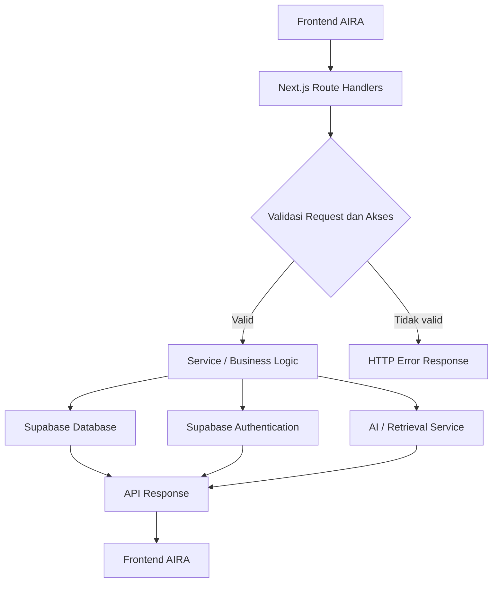

# API Documentation — AIRA

Dokumentasi ini menjelaskan Application Programming Interface (API) yang digunakan pada website AIRA (Access, Intelligence, Resilience, Action), termasuk endpoint, fungsi, mekanisme autentikasi, validasi data, alur pengelolaan resource, dan hasil pengujian API.

Backend API AIRA dibangun menggunakan Next.js Route Handlers dan terintegrasi dengan Supabase sebagai layanan database serta autentikasi. API mendukung kebutuhan kalkulasi ketahanan air, pengelolaan data rumah tangga, riwayat asesmen, Navigasi Air, AIRA Assistant, kontribusi titik air, dan pengelolaan sistem oleh admin.

Pengujian API telah dilakukan oleh tim menggunakan Thunder Client untuk memeriksa fungsionalitas endpoint, respons API, alur pengelolaan data, serta mekanisme autentikasi dan otorisasi. Berdasarkan hasil pengujian yang dilakukan, endpoint API yang diuji dapat berjalan sesuai kebutuhan fungsional aplikasi dan tidak ditemukan kendala yang menghambat alur penggunaan pada pengujian tersebut.

---

## 1. Informasi API

| Informasi | Keterangan |
|---|---|
| Nama aplikasi | AIRA — Access, Intelligence, Resilience, Action |
| Backend | Next.js Route Handlers |
| Database | Supabase PostgreSQL |
| Authentication | Supabase Authentication |
| API format | JSON |
| API documentation | `/api-docs` |
| OpenAPI specification | `/api/openapi` |
| API testing tool | Thunder Client |
| Local environment | `http://localhost:3000` |
| Production environment | `https://aira-for-every-woman.vercel.app` |

API digunakan sebagai penghubung antara antarmuka website, layanan backend, database Supabase, dan layanan AI yang digunakan pada AIRA Assistant. Setiap endpoint memiliki fungsi dan tingkat akses yang disesuaikan dengan kebutuhan fitur serta jenis data yang dikelola.

## 2. Arsitektur dan alur komunikasi API

API AIRA berperan sebagai lapisan komunikasi antara frontend dan layanan backend. Request yang dikirimkan melalui website diterima oleh Route Handler, kemudian diproses sesuai fungsi endpoint, termasuk validasi input, pemeriksaan sesi pengguna, pemeriksaan hak akses, pengambilan atau penyimpanan data, serta pemanggilan layanan eksternal jika diperlukan.



Secara umum, alur komunikasi API meliputi:

1\. Frontend mengirimkan request melalui HTTP method yang sesuai dengan kebutuhan operasi.
2\. Backend menerima request dan memeriksa format, parameter, serta validitas input.
3\. Endpoint yang memerlukan autentikasi memeriksa sesi pengguna dan hak akses pada sisi server.
4\. Request diproses melalui business logic yang sesuai dengan fitur.
5\. Backend berinteraksi dengan Supabase atau layanan pendukung apabila diperlukan.
6\. Hasil pemrosesan dikembalikan kepada frontend dalam bentuk respons HTTP dan data JSON.

Pada endpoint yang berkaitan dengan AI, backend juga berperan dalam mengelola proses retrieval dokumen, pemanggilan model AI, serta pengembalian jawaban dan referensi yang tersedia.

## 3. Format request dan response

### 3.1 Format request

API menggunakan HTTP method sesuai jenis operasi yang dilakukan. Endpoint yang menerima data JSON menggunakan `Content-Type: application/json`.

HTTP method yang digunakan meliputi:

| Method | Fungsi |
|---|---|
| GET | Mengambil data atau informasi resource. |
| POST | Mengirim data, membuat resource, atau menjalankan proses tertentu. |
| PATCH | Memperbarui sebagian data resource. |
| DELETE | Menghapus atau menonaktifkan resource sesuai aturan sistem. |

### 3.2 Format respons sukses

Sebagian besar endpoint menggunakan struktur respons sukses yang memuat status keberhasilan, pesan, dan data hasil pemrosesan.

```json
{
  "success": true,
  "message": "Permintaan berhasil.",
  "data": {}
}
```

Struktur tersebut menjadi pola respons yang digunakan pada endpoint yang mengikuti response helper aplikasi. Beberapa endpoint administratif menggunakan format respons langsung dari `NextResponse.json`, sehingga struktur data dapat menyesuaikan implementasi route masing-masing.

### 3.3 Format respons error

Respons error digunakan untuk menyampaikan kondisi ketika request tidak dapat diproses, seperti input yang tidak valid, resource yang tidak ditemukan, atau akses yang tidak memenuhi ketentuan.

```json
{
  "success": false,
  "message": "Data tidak valid.",
  "error": {
    "code": "VALIDATION_ERROR",
    "details": null
  }
}
```

Respons error membantu frontend memahami kondisi request dan menampilkan informasi yang sesuai kepada pengguna.

### 3.4 HTTP status code

| HTTP Status | Keterangan |
|---|---|
| `200 OK` | Request berhasil diproses. |
| `201 Created` | Resource atau data baru berhasil dibuat. |
| `400 Bad Request` | Request tidak memenuhi format atau parameter yang dibutuhkan. |
| `401 Unauthorized` | Request tidak memiliki sesi autentikasi yang valid. |
| `403 Forbidden` | Request tidak memiliki hak akses yang sesuai. |
| `404 Not Found` | Resource tidak ditemukan atau tidak dapat diakses. |
| `409 Conflict` | Request bertentangan dengan kondisi atau relasi data yang sedang berlaku. |
| `422 Unprocessable Entity` | Input tidak memenuhi validasi data atau aturan bisnis. |
| `429 Too Many Requests` | Request melebihi batas permintaan apabila mekanisme rate limiting diterapkan. |
| `502 Bad Gateway` | Terjadi kegagalan pada layanan upstream. |
| `503 Service Unavailable` | Layanan atau dependency tidak tersedia. |
| `504 Gateway Timeout` | Request mengalami timeout pada layanan yang digunakan. |

Status code yang dikembalikan bergantung pada kondisi pemrosesan dan implementasi endpoint.

## 4. Autentikasi dan otorisasi

AIRA menggunakan Supabase Authentication untuk mengelola identitas dan sesi pengguna. Endpoint yang berkaitan dengan data akun, rumah tangga, riwayat asesmen, kontribusi, dan pengelolaan admin memiliki mekanisme autentikasi serta pemeriksaan hak akses sesuai kebutuhan resource.

### 4.1 Kategori akses API

| Kategori | Endpoint | Keterangan |
|---|---|---|
| Public | `/api/assistant` | Mengirim pertanyaan ke AIRA Assistant. |
| Public | `/api/water-navigation` | Mengambil daftar titik air publik. |
| Public | `/api/water-navigation/{id}` | Mengambil detail titik air publik. |
| Public / Guest | `POST /api/water-assessments` | Menjalankan kalkulasi ketahanan air. |
| Authenticated User | `/api/profile` | Mengakses profil akun. |
| Authenticated User | `/api/households` | Mengakses dan mengelola data rumah tangga. |
| Authenticated User | `/api/water-assessments` | Mengakses riwayat asesmen. |
| Authenticated User | `/api/contributions` | Mengakses dan mengelola kontribusi pengguna. |
| Admin | `/api/admin/\*` | Mengelola data dan aktivitas administratif. |

### 4.2 Pemeriksaan autentikasi dan otorisasi

Pada endpoint yang memerlukan autentikasi, identitas pengguna diperoleh melalui pemeriksaan sesi Supabase pada sisi server.

Pengelolaan akses tidak bergantung pada `user_id`, `owner_user_id`, `assessed_by_user_id`, `contributor_user_id`, atau role yang dikirim melalui request dari frontend. Identitas dan hak akses diperiksa oleh backend sesuai konteks operasi.

Pada endpoint administratif, pemeriksaan role dan status akun digunakan untuk memastikan bahwa operasi pengelolaan hanya dapat dilakukan oleh akun admin yang memiliki hak akses sesuai implementasi.

### 4.3 Pengujian autentikasi dan otorisasi

Pemeriksaan autentikasi dan akses API turut menjadi bagian dari pengujian Thunder Client. Pengujian dilakukan pada endpoint yang memiliki perbedaan hak akses, termasuk endpoint pengguna dan endpoint administratif.

Berdasarkan pengujian API yang dilakukan tim, mekanisme akses endpoint berjalan sesuai fungsi yang diharapkan pada skenario pengujian. Request yang berkaitan dengan operasi terproteksi ditangani berdasarkan autentikasi dan hak akses yang dimiliki.

## 5. Inventaris endpoint API

Daftar berikut merangkum endpoint API yang digunakan pada website AIRA berdasarkan kelompok fitur dan fungsi operasionalnya.

### 5.1 Endpoint pengguna dan fitur publik

| Method | Endpoint | Akses | Fungsi |
|---|---|---|---|
| POST | `/api/assistant` | Public | Mengirim pertanyaan dan memperoleh respons AIRA Assistant. |
| GET | `/api/water-navigation` | Public | Mengambil daftar titik air yang memenuhi kriteria publikasi. |
| GET | `/api/water-navigation/{id}` | Public | Mengambil detail titik air. |
| POST | `/api/water-assessments` | Public / Guest | Menjalankan kalkulasi ketahanan air dan menyimpan hasil jika kondisi autentikasi serta penyimpanan terpenuhi. |
| GET | `/api/profile` | User | Mengambil profil akun pengguna aktif. |
| GET | `/api/households` | User | Mengambil data rumah tangga milik pengguna. |
| POST | `/api/households` | User | Membuat profil rumah tangga pertama atau memperbarui profil terbaru. |
| PATCH | `/api/households/{id}` | User | Memperbarui data rumah tangga tertentu. |
| DELETE | `/api/households/{id}` | User | Menghapus data rumah tangga sesuai aturan dependensi. |
| GET | `/api/water-assessments` | User | Mengambil riwayat asesmen milik pengguna. |
| GET | `/api/water-assessments/{id}` | User | Mengambil detail asesmen tertentu. |
| PATCH | `/api/water-assessments/{id}` | User | Memperbarui catatan asesmen. |
| DELETE | `/api/water-assessments/{id}` | User | Menghapus asesmen sesuai aturan kepemilikan dan dependensi. |
| GET | `/api/contributions` | User | Mengambil riwayat kontribusi pengguna. |
| POST | `/api/contributions` | User | Mengirim usulan titik air atau pembaruan informasi titik air. |
| GET | `/api/contributions/{id}` | User | Mengambil detail kontribusi milik pengguna. |
| PATCH | `/api/contributions/{id}` | User | Memperbarui kontribusi yang memenuhi kondisi pengeditan. |
| DELETE | `/api/contributions/{id}` | User | Membatalkan kontribusi sesuai aturan status dan review. |

### 5.2 Endpoint administratif

| Method | Endpoint | Akses | Fungsi |
|---|---|---|---|
| GET | `/api/admin/overview` | Admin | Mengambil ringkasan dashboard admin. |
| GET | `/api/admin/contributions` | Admin | Mengambil antrean kontribusi. |
| GET | `/api/admin/contributions/{id}` | Admin | Mengambil detail kontribusi. |
| PATCH | `/api/admin/contributions/{id}` | Admin | Memproses review kontribusi. |
| GET | `/api/admin/water-points` | Admin | Mengambil daftar titik air untuk pengelolaan. |
| POST | `/api/admin/water-points` | Admin | Menambahkan titik air melalui pengelolaan administratif. |
| GET | `/api/admin/water-points/{id}` | Admin | Mengambil detail titik air. |
| PATCH | `/api/admin/water-points/{id}` | Admin | Memperbarui data titik air. |
| DELETE | `/api/admin/water-points/{id}` | Admin | Menonaktifkan titik air sesuai mekanisme pengelolaan. |
| GET | `/api/admin/users` | Admin | Mengambil daftar pengguna. |
| GET | `/api/admin/users/{id}` | Admin | Mengambil detail pengguna. |
| PATCH | `/api/admin/users/{id}/status` | Admin | Mengubah status akun pengguna. |
| GET | `/api/admin/users/stats` | Admin | Mengambil statistik pengguna. |
| GET | `/api/admin/activity-logs` | Admin | Mengambil riwayat aktivitas admin. |

### 5.3 Endpoint dokumentasi API

| Method | Endpoint | Akses | Fungsi |
|---|---|---|---|
| GET | `/api/openapi` | Public | Mengambil spesifikasi OpenAPI. |

Swagger UI tersedia melalui `/api-docs` untuk melihat dokumentasi endpoint, struktur request, parameter, serta respons API yang didokumentasikan.

## 6. Dokumentasi request dan proses endpoint

### 6.1 AIRA Assistant — Retrieval-Augmented Generation (RAG)

\*\*Endpoint:\*\* `POST /api/assistant`

AIRA Assistant menggunakan pendekatan Retrieval-Augmented Generation (RAG) untuk membantu pengguna memperoleh informasi mengenai air, sanitasi, pengelolaan air rumah tangga, dan topik terkait ketahanan air.

Endpoint menerima pertanyaan pengguna dan riwayat percakapan apabila tersedia. Request diproses melalui backend yang mengelola retrieval sumber informasi dan pemanggilan model AI, kemudian mengembalikan jawaban beserta referensi yang tersedia.

\*\*Contoh request:\*\*

```json
{
  "question": "Bagaimana cara menghemat air saat musim kemarau?",
  "history": [
    {
      "role": "user",
      "content": "Apa yang dimaksud dengan ketahanan air rumah tangga?"
    }
  ]
}
```

\*\*Parameter request:\*\*

| Parameter | Tipe | Keterangan |
|---|---|---|
| `question` | String | Pertanyaan pengguna, wajib diisi, panjang 1–2.000 karakter. |
| `history` | Array | Riwayat percakapan sebelumnya, bersifat opsional. |
| `history[].role` | String | Peran pesan, menggunakan `user` atau `assistant`. |
| `history[].content` | String | Isi pesan, berupa teks maksimal 1.500 karakter. |

Riwayat percakapan bersifat opsional dan dapat digunakan untuk mempertahankan konteks percakapan. Jumlah riwayat yang diterima pada request dibatasi maksimal enam pesan sesuai validasi endpoint.

\*\*Contoh response:\*\*

```json
{
  "success": true,
  "message": "Jawaban AIRA Assistant berhasil dibuat.",
  "data": {
    "answer": "Gunakan air sesuai kebutuhan, periksa kebocoran, dan simpan air dalam wadah tertutup.",
    "mode": "rag",
    "sources": [
      {
        "title": "Panduan Penghematan Air Rumah Tangga",
        "publisher": "Dokumen referensi AIRA",
        "page_start": 4,
        "page_end": 5
      }
    ],
    "historySaved": false
  }
}
```

\*\*Data respons:\*\*

| Field | Keterangan |
|---|---|
| `answer` | Jawaban yang dihasilkan oleh Assistant. |
| `mode` | Mode pemrosesan yang digunakan. |
| `sources` | Referensi yang digunakan atau tersedia dalam proses jawaban. |
| `historySaved` | Status penyimpanan riwayat percakapan pengguna. |

`historySaved` menunjukkan apakah riwayat percakapan berhasil disimpan untuk pengguna yang memiliki sesi login. Pengguna tamu dapat menggunakan Assistant tanpa penyimpanan riwayat akun.

Pada endpoint ini, timeout request yang didokumentasikan adalah 45 detik. Pemanggilan model AI dan retrieval dapat dipengaruhi oleh ketersediaan layanan eksternal, sehingga mekanisme fallback dan penanganan kegagalan merupakan bagian dari pengelolaan request.

### 6.2 Kalkulator Ketahanan Air

\*\*Endpoint:\*\* `POST /api/water-assessments`

Endpoint ini digunakan untuk memproses data rumah tangga dan kebutuhan air dalam kalkulasi ketahanan air. Data yang diterima meliputi lokasi, jumlah anggota rumah tangga, sumber air utama, kondisi ketersediaan air, kapasitas air, persentase ketersediaan, informasi MHM, dan luas atap apabila tersedia.

\*\*Contoh request:\*\*

```json
{
  "lokasi": "Rongkop, Gunungkidul",
  "anggota": 4,
  "sumberAir": "Sumur Gali/Bor",
  "kondisi": "Terbatas",
  "kapasitas": 1200,
  "persen": 50,
  "mhm": true,
  "anggotaMhm": 2,
  "luasAtap": 60
}
```

\*\*Validasi input yang didokumentasikan:\*\*

| Parameter | Ketentuan |
|---|---|
| `lokasi` | Informasi lokasi rumah tangga. |
| `anggota` | Bilangan bulat 1–30. |
| `sumberAir` | Menggunakan pilihan sumber air yang didukung. |
| `kondisi` | Menggunakan pilihan kondisi yang didukung. |
| `kapasitas` | Lebih dari 0 dan maksimal 100.000 liter. |
| `persen` | Nilai 0–100. |
| `mhm` | Boolean untuk kondisi terkait MHM. |
| `anggotaMhm` | Jumlah anggota terkait MHM apabila relevan. |
| `luasAtap` | Opsional, 0–1.000 m². |

Endpoint kalkulator dapat digunakan oleh pengguna tanpa login. Apabila pengguna memiliki sesi autentikasi dan proses penyimpanan berhasil, hasil asesmen dapat dikaitkan dengan akun untuk kebutuhan riwayat.

Jika data estimasi curah hujan untuk wilayah yang dipilih tidak tersedia, sistem tidak menggunakan data wilayah lain sebagai pengganti estimasi wilayah pengguna.

### 6.3 Profil rumah tangga

\*\*Endpoint:\*\* `POST /api/households`

Endpoint ini digunakan untuk menyimpan atau memperbarui profil rumah tangga pengguna yang telah login.

\*\*Contoh request:\*\*

```json
{
  "namaRumahTangga": "Keluarga Sejahtera",
  "wilayahDesa": "Desa Semugih, Rongkop",
  "anggota": 4,
  "mhm": true,
  "anggotaMhm": 2,
  "sumberAir": "Sumur Gali/Bor",
  "kapasitas": 1200
}
```

Operasi POST pada endpoint ini menggunakan mekanisme create-or-update. Apabila pengguna belum memiliki profil rumah tangga, data baru dibuat. Apabila profil telah tersedia, sistem memperbarui profil terbaru milik pengguna.

Endpoint rumah tangga lainnya meliputi:

| Method | Endpoint | Fungsi |
|---|---|---|
| GET | `/api/households` | Mengambil data rumah tangga pengguna. |
| PATCH | `/api/households/{id}` | Memperbarui data rumah tangga berdasarkan ID. |
| DELETE | `/api/households/{id}` | Menghapus rumah tangga sesuai aturan dependensi. |

Operasi penghapusan mempertimbangkan keterkaitan data dengan anggota rumah tangga, asesmen, dan interaksi terkait agar tidak menghilangkan data yang masih diperlukan oleh resource lain.

### 6.4 Riwayat asesmen

Endpoint asesmen menyediakan akses terhadap hasil kalkulasi yang tersimpan pada akun pengguna.

| Method | Endpoint | Fungsi |
|---|---|---|
| GET | `/api/water-assessments` | Mengambil daftar riwayat asesmen. |
| GET | `/api/water-assessments/{id}` | Mengambil detail asesmen. |
| PATCH | `/api/water-assessments/{id}` | Memperbarui catatan asesmen. |
| DELETE | `/api/water-assessments/{id}` | Menghapus asesmen sesuai aturan sistem. |

Pada operasi PATCH, pembaruan ditujukan pada catatan asesmen (`assessment_notes`) dan tidak dimaksudkan untuk mengubah nilai kalkulasi maupun snapshot input yang menjadi dasar hasil asesmen.

Pada operasi DELETE, endpoint menggunakan mekanisme penghapusan yang memeriksa kepemilikan data dan dependensi asesmen. Implementasi yang didokumentasikan menggunakan RPC `delete_my_water_assessment` untuk memproses penghapusan asesmen beserta dependensi langsung yang terkait sesuai aturan sistem.

### 6.5 Navigasi Air

\*\*Endpoint:\*\*

\- `GET /api/water-navigation`
\- `GET /api/water-navigation/{id}`

Navigasi Air menyediakan informasi titik air yang dapat diakses secara publik. Endpoint digunakan untuk menampilkan daftar titik air dan detail lokasi, termasuk informasi yang berkaitan dengan sumber air, lokasi, ketersediaan, akses, serta informasi pendukung lainnya sesuai data yang tersedia.

\*\*GET `/api/water-navigation`\*\*

Endpoint digunakan untuk mengambil daftar titik air yang memenuhi kriteria publikasi.

Kriteria publikasi yang digunakan pada sistem meliputi:

\- Titik air berstatus terverifikasi.
\- Titik air aktif.
\- Titik air bukan data simulasi.

\*\*GET `/api/water-navigation/{id}`\*\*

Endpoint digunakan untuk mengambil detail titik air berdasarkan ID yang dapat diakses secara publik.

Endpoint detail digunakan untuk mendukung tampilan informasi titik air, termasuk lokasi, informasi ketersediaan, dan detail akses yang tersedia pada record.

### 6.6 Kontribusi titik air oleh pengguna

\*\*Endpoint:\*\* `POST /api/contributions`

Kontribusi pengguna digunakan untuk mengirimkan informasi titik air baru atau usulan pembaruan informasi titik air yang sudah tersedia. Data kontribusi tidak langsung dipublikasikan melalui Navigasi Air karena harus melalui proses verifikasi admin.

\*\*Contoh request kontribusi titik air baru:\*\*

```json
{
  "contribution_type": "new_point",
  "proposed_point_name": "Sumur Komunal RT 04",
  "proposed_water_source_type": "public_well",
  "proposed_province_id": 34,
  "proposed_city_regency_id": 3403,
  "proposed_district_id": 340312,
  "proposed_village": "Semugih",
  "proposed_address_detail": "RT 04/RW 02",
  "proposed_latitude": -8.045,
  "proposed_longitude": 110.735,
  "proposed_availability_status": "available",
  "proposed_access_information": "Pengelola: Kelompok Air RT 04",
  "proposed_opening_hours": "06.00-18.00",
  "evidence_url": "https://maps.google.com/?q=-8.045,110.735",
  "notes": "Saya melihat langsung."
}
```

Jenis kontribusi yang didukung:

| Jenis | Keterangan |
|---|---|
| `new_point` | Usulan penambahan titik air baru. |
| `update_point` | Usulan pembaruan informasi titik air yang telah tersedia. |

Pada kontribusi `update_point`, referensi `water_point_id` digunakan untuk mengidentifikasi titik air yang menjadi target usulan pembaruan sesuai implementasi endpoint.

\*\*Endpoint kontribusi pengguna:\*\*

| Method | Endpoint | Fungsi |
|---|---|---|
| GET | `/api/contributions` | Mengambil riwayat kontribusi pengguna. |
| POST | `/api/contributions` | Mengirim kontribusi. |
| GET | `/api/contributions/{id}` | Mengambil detail kontribusi. |
| PATCH | `/api/contributions/{id}` | Memperbarui kontribusi yang memenuhi kondisi revisi. |
| DELETE | `/api/contributions/{id}` | Membatalkan kontribusi sesuai aturan status. |

Kontribusi pengguna memiliki status proses yang berkaitan dengan verifikasi, antara lain:

\- `pending`: menunggu proses verifikasi.
\- `approved`: disetujui.
\- `rejected`: ditolak.
\- `needs_revision`: memerlukan perbaikan dari pengirim.

Status verifikasi tidak ditentukan oleh pengguna melalui request kontribusi. Penetapan status review dilakukan melalui proses administratif.

### 6.7 Review kontribusi oleh admin

\*\*Endpoint:\*\* `PATCH /api/admin/contributions/{id}`

Endpoint digunakan untuk memproses review terhadap kontribusi yang dikirimkan pengguna.

\*\*Contoh request:\*\*

```json
{
  "reviewStatus": "needs_revision",
  "reviewNotes": "Mohon lengkapi jam akses dan nama pengelola."
}
```

Status review yang digunakan meliputi:

| Status | Fungsi |
|---|---|
| `approved` | Menyetujui kontribusi sesuai hasil verifikasi. |
| `rejected` | Menolak kontribusi. |
| `needs_revision` | Meminta pengirim melengkapi atau memperbaiki data. |

Pada keputusan `approved`, data ketersediaan air dapat ditentukan melalui nilai yang didukung sistem, yaitu `available`, `limited`, `unavailable`, atau `unknown`, sesuai aturan endpoint review.

Proses review menjadi bagian dari pengendalian kualitas informasi Navigasi Air. Kontribusi yang belum memenuhi kriteria verifikasi tidak ditampilkan sebagai titik air publik yang terkonfirmasi.

### 6.8 Pengelolaan titik air oleh admin

Endpoint pengelolaan titik air digunakan untuk mengelola record titik air pada database melalui akses administratif.

| Method | Endpoint | Fungsi |
|---|---|---|
| GET | `/api/admin/water-points` | Mengambil daftar titik air untuk pengelolaan admin. |
| POST | `/api/admin/water-points` | Menambahkan titik air melalui operasi administratif. |
| GET | `/api/admin/water-points/{id}` | Mengambil detail titik air. |
| PATCH | `/api/admin/water-points/{id}` | Memperbarui data titik air. |
| DELETE | `/api/admin/water-points/{id}` | Menonaktifkan titik air. |

Daftar titik air admin mendukung parameter filter dan pagination sesuai implementasi, termasuk pencarian nama, status verifikasi, status ketersediaan, dan status aktif.

Jenis sumber air yang didukung pada pengelolaan titik air meliputi:

\- `public_well`
\- `spring`
\- `storage_tank`
\- `emergency_tank`
\- `hydrant`
\- `reservoir`
\- `water_station`
\- `other`

Status ketersediaan yang digunakan meliputi:

\- `available`
\- `limited`
\- `unavailable`
\- `unknown`

Operasi DELETE pada pengelolaan titik air menggunakan mekanisme penonaktifan (`is_active=false`) sesuai implementasi yang didokumentasikan, sehingga record tidak dihapus permanen. Mekanisme tersebut menjaga agar data dan relasi yang masih diperlukan tetap tersedia pada database.

### 6.9 Pengelolaan akun pengguna oleh admin

| Method | Endpoint | Fungsi |
|---|---|---|
| GET | `/api/admin/users` | Mengambil daftar akun pengguna. |
| GET | `/api/admin/users/{id}` | Mengambil detail akun pengguna. |
| PATCH | `/api/admin/users/{id}/status` | Mengubah status akun. |
| GET | `/api/admin/users/stats` | Mengambil statistik akun pengguna. |

Endpoint pengelolaan akun digunakan untuk mendukung kebutuhan administratif, termasuk pemantauan akun, pengambilan informasi pengguna, dan pengelolaan status akun sesuai hak akses admin.

### 6.10 Admin overview dan activity logs

| Method | Endpoint | Fungsi |
|---|---|---|
| GET | `/api/admin/overview` | Mengambil ringkasan data dashboard admin. |
| GET | `/api/admin/activity-logs` | Mengambil riwayat aktivitas admin. |

Admin overview digunakan untuk menampilkan ringkasan informasi operasional yang berkaitan dengan pengelolaan sistem. Activity logs digunakan untuk menampilkan catatan aktivitas administratif sesuai data yang tersedia.

## 7. Pengelolaan resource dan implementasi CRUD

Operasi CRUD pada API AIRA disesuaikan dengan fungsi resource, aturan kepemilikan, dependensi database, serta alur bisnis aplikasi.

| Resource | Create | Read | Update | Delete |
|---|---|---|---|---|
| Household | POST | GET | POST create-or-update dan PATCH | DELETE sesuai dependensi |
| Water Assessment | POST | GET list/detail | PATCH catatan | DELETE sesuai aturan dependensi |
| Contribution | POST | GET list/detail | PATCH untuk kontribusi yang memenuhi kondisi revisi | DELETE untuk pembatalan yang memenuhi kondisi |
| Water Point Admin | POST | GET list/detail | PATCH | DELETE berupa penonaktifan |

Implementasi CRUD tidak selalu menggunakan pola operasi yang identik pada setiap resource. Beberapa operasi memiliki aturan khusus untuk menjaga integritas data.

### 7.1 Household

Pengelolaan rumah tangga memiliki mekanisme create-or-update pada POST, pembaruan melalui PATCH, serta penghapusan yang mempertimbangkan relasi data.

### 7.2 Water Assessment

Assessment menyimpan hasil kalkulasi yang berkaitan dengan input rumah tangga dan hasil evaluasi ketahanan air. Pembaruan pada resource dibatasi pada catatan asesmen, sedangkan penghapusan mempertimbangkan dependensi rekomendasi dan interaksi yang terkait.

### 7.3 Contribution

Contribution merupakan data usulan yang memiliki riwayat proses verifikasi. Perubahan data pengguna dibatasi berdasarkan status kontribusi, sedangkan proses persetujuan dan penolakan dilakukan melalui endpoint admin.

### 7.4 Water Point

Water Point merupakan resource yang digunakan pada Navigasi Air. Pengelolaan administratif mencakup pembuatan, pengambilan, pembaruan, dan penonaktifan data sesuai aturan publikasi dan pengelolaan record.

Dengan demikian, implementasi CRUD pada AIRA mengikuti kebutuhan dan batasan domain masing-masing resource, bukan sekadar menyediakan operasi generik untuk seluruh tabel.

## 8. Pengujian API menggunakan Thunder Client

Pengujian API dilakukan oleh tim menggunakan Thunder Client untuk memastikan endpoint yang digunakan pada website AIRA dapat berfungsi sesuai kebutuhan sistem.

Pengujian mencakup endpoint fitur publik, endpoint yang memerlukan autentikasi pengguna, endpoint pengelolaan data, serta endpoint administratif. Request dan respons API diperiksa melalui Thunder Client untuk melihat hasil pemrosesan, data yang dikembalikan, serta alur interaksi endpoint.

### 8.1 Tujuan pengujian

Pengujian API dilakukan untuk:

\- Memastikan endpoint dapat menerima dan memproses request sesuai fungsi.
\- Memastikan respons API dapat digunakan oleh frontend.
\- Memastikan proses pengambilan, pembuatan, pembaruan, dan pengelolaan data berjalan sesuai implementasi.
\- Memeriksa alur autentikasi dan otorisasi pada endpoint yang memiliki batas akses.
\- Memeriksa interaksi API dengan database dan layanan pendukung.
\- Memastikan endpoint administratif dapat mendukung pengelolaan data sesuai fungsi sistem.

### 8.2 Ruang lingkup pengujian

| Kelompok pengujian | Endpoint / fitur | Fokus pengujian |
|---|---|---|
| Assistant | `/api/assistant` | Pemrosesan pertanyaan, respons, retrieval, dan referensi. |
| Kalkulator | `/api/water-assessments` | Pemrosesan input kalkulasi dan penyimpanan hasil. |
| Rumah tangga | `/api/households` | Pengambilan, pembuatan, pembaruan, dan pengelolaan data. |
| Riwayat asesmen | `/api/water-assessments` | Pengambilan, pembaruan catatan, dan pengelolaan asesmen. |
| Navigasi Air | `/api/water-navigation` | Pengambilan daftar dan detail titik air. |
| Kontribusi | `/api/contributions` | Pengiriman, pengambilan, pembaruan, dan pembatalan kontribusi sesuai kondisi. |
| Review kontribusi | `/api/admin/contributions` | Proses verifikasi dan pengelolaan status kontribusi. |
| Admin water points | `/api/admin/water-points` | Pengelolaan data titik air. |
| Admin users | `/api/admin/users` | Pengambilan informasi dan pengelolaan status akun. |
| Admin overview | `/api/admin/overview` | Pengambilan ringkasan data administratif. |
| Activity logs | `/api/admin/activity-logs` | Pengambilan catatan aktivitas admin. |
| OpenAPI | `/api/openapi` | Pengambilan dokumentasi spesifikasi API. |

### 8.3 Hasil pengujian API

Berdasarkan pengujian yang dilakukan menggunakan Thunder Client, endpoint API yang diuji dapat berjalan dengan baik sesuai fungsi yang diimplementasikan pada AIRA.

| Aspek | Hasil pengujian |
|---|---|
| Pemanggilan endpoint | Endpoint yang diuji dapat menerima dan memproses request sesuai fungsi. |
| Respons API | Respons dikembalikan sesuai proses yang dijalankan oleh endpoint. |
| Pengambilan data | Endpoint pengambilan data dapat mendukung kebutuhan akses informasi aplikasi. |
| Pengelolaan data | Operasi pengelolaan resource yang diuji berjalan sesuai alur implementasi. |
| Autentikasi | Endpoint terproteksi menggunakan mekanisme autentikasi sesuai kebutuhan akses. |
| Otorisasi | Pengelolaan endpoint mengikuti pembatasan hak akses pengguna dan admin. |
| Integrasi database | Proses API yang berkaitan dengan penyimpanan dan pengambilan data berjalan sesuai pengujian. |
| Integrasi fitur | API mendukung alur fitur utama dan fitur pendukung pada website AIRA. |

\<details>

Pada pengujian menggunakan Thunder Client, tim tidak menemukan kendala yang menghambat proses pengujian endpoint yang dilakukan. Hasil tersebut menjadi bukti bahwa API telah diuji secara fungsional sebagai bagian dari implementasi website AIRA.

Hasil pengujian ini menggambarkan kondisi endpoint pada lingkup pengujian yang dilakukan. Hasil tersebut tidak dimaksudkan sebagai klaim bahwa seluruh kemungkinan kombinasi request, beban sistem, konfigurasi deployment, atau skenario keamanan telah diuji secara menyeluruh.

\</details>

### 8.4 Rekapitulasi hasil pengujian API

| Kategori | Hasil |
|---|---|
| API fitur utama | Berjalan sesuai fungsi pada pengujian. |
| API data pengguna | Berjalan sesuai fungsi pada pengujian. |
| API kontribusi | Berjalan sesuai fungsi pada pengujian. |
| API administratif | Berjalan sesuai fungsi pada pengujian. |
| API integrasi data | Berjalan sesuai fungsi pada pengujian. |
| API autentikasi dan otorisasi | Berjalan sesuai mekanisme akses pada pengujian. |

\<details>

Rekapitulasi tersebut merupakan ringkasan hasil pengujian tim menggunakan Thunder Client. Pengujian API menjadi bagian dari validasi teknis yang mendukung implementasi fitur, integrasi backend, dan pengelolaan data pada AIRA.

\</details>

## 9. Integrasi API dengan frontend AIRA

API digunakan untuk mendukung interaksi frontend dengan layanan backend pada setiap fitur website.

| Fitur frontend | API yang digunakan | Peran API |
|---|---|---|
| Kalkulator Ketahanan Air | `POST /api/water-assessments` | Memproses kalkulasi ketahanan air dan penyimpanan hasil. |
| Riwayat Kalkulator | `GET /api/water-assessments` | Mengambil riwayat asesmen pengguna. |
| Detail Riwayat | `GET /api/water-assessments/{id}` | Mengambil detail asesmen. |
| Monitoring / catatan | `PATCH /api/water-assessments/{id}` | Memperbarui catatan asesmen. |
| Navigasi Air | `GET /api/water-navigation` | Menampilkan daftar titik air publik. |
| Detail Navigasi Air | `GET /api/water-navigation/{id}` | Menampilkan detail titik air. |
| AIRA Assistant | `POST /api/assistant` | Memproses pertanyaan dan menghasilkan jawaban berbasis retrieval. |
| Profil Rumah Tangga | `/api/households` | Mengambil dan mengelola data rumah tangga. |
| Kontribusi Air | `/api/contributions` | Mengirim dan mengelola kontribusi pengguna. |
| Dashboard Admin | `/api/admin/overview` | Menyediakan ringkasan administratif. |
| Verifikasi Kontribusi | `/api/admin/contributions` | Mendukung proses review kontribusi. |
| Admin Kelola Titik Air | `/api/admin/water-points` | Mendukung pengelolaan data titik air. |
| Admin Pengguna | `/api/admin/users` | Mendukung pengelolaan akun pengguna. |

Integrasi tersebut memungkinkan frontend menggunakan layanan backend untuk mengambil data, memproses input, menampilkan hasil kalkulasi, mengelola kontribusi, serta mendukung fungsi administratif.

## 10. Keamanan dan pengelolaan data API

Keamanan API AIRA diterapkan melalui autentikasi, pemeriksaan hak akses, validasi request, dan aturan pengelolaan data pada backend.

### 10.1 Autentikasi dan pemeriksaan akses

Endpoint privat menggunakan sesi Supabase dan pemeriksaan identitas pada sisi server. Endpoint administratif menggunakan pemeriksaan hak akses sesuai role dan status akun.

### 10.2 Validasi input

Validasi input dilakukan pada request yang diterima endpoint, termasuk parameter, tipe data, nilai yang diperbolehkan, panjang teks, dan aturan bisnis sesuai kebutuhan resource.

### 10.3 Kepemilikan data

Endpoint yang mengelola data pengguna mempertimbangkan kepemilikan resource. Data rumah tangga, asesmen, dan kontribusi memiliki keterkaitan dengan identitas pengguna sesuai implementasi.

### 10.4 Pengelolaan data publik

Navigasi Air menggunakan kriteria publikasi yang berkaitan dengan status verifikasi, status aktif, dan status simulasi. Kontribusi pengguna melalui proses review sebelum menjadi informasi titik air publik yang terkonfirmasi.

### 10.5 Integritas data

Operasi pembaruan dan penghapusan mempertimbangkan relasi data, dependensi, serta aturan yang digunakan oleh resource terkait. Mekanisme pengelolaan tersebut membantu mempertahankan integritas informasi pada database.

### 10.6 Hasil pengujian keamanan API

Pemeriksaan autentikasi dan otorisasi endpoint turut dilakukan dalam pengujian API menggunakan Thunder Client.

Berdasarkan pengujian yang dilakukan tim, endpoint API berjalan sesuai mekanisme akses yang diterapkan pada sistem. Pengujian tersebut mendukung evaluasi fungsionalitas API, termasuk penggunaan endpoint yang memiliki batasan akses.

Hasil pengujian ini menjadi bagian dari validasi teknis API AIRA. Penilaian keamanan menyeluruh seperti penetration testing, audit konfigurasi deployment, pengujian beban, dan pemeriksaan seluruh kemungkinan eksploitasi tidak dinyatakan sebagai bagian dari pengujian Thunder Client apabila belum dilakukan secara khusus.

## 11. Dokumentasi OpenAPI dan Swagger

AIRA menyediakan dokumentasi spesifikasi API melalui OpenAPI JSON dan Swagger UI.

| Resource | URL |
|---|---|
| OpenAPI JSON | `/api/openapi` |
| Swagger UI | `/api-docs` |

OpenAPI digunakan untuk mendokumentasikan endpoint, HTTP method, parameter, request body, struktur respons, dan informasi akses yang tersedia pada spesifikasi.

Swagger UI menyediakan antarmuka untuk melihat dokumentasi API secara lebih terstruktur. Dokumentasi tersebut mendukung pemahaman alur endpoint dan integrasi API pada aplikasi.

## 12. Kesimpulan pengujian dan implementasi API

API AIRA telah diimplementasikan untuk mendukung fitur utama dan fitur pendukung website, meliputi kalkulasi ketahanan air, AIRA Assistant, Navigasi Air, pengelolaan rumah tangga, riwayat asesmen, kontribusi pengguna, serta pengelolaan data oleh admin.

Pengujian API telah dilakukan menggunakan Thunder Client. Berdasarkan hasil pengujian tim, endpoint yang diuji dapat berjalan dengan baik sesuai fungsi dan kebutuhan implementasi. Pengujian mencakup pemanggilan endpoint, respons API, proses pengelolaan data, serta mekanisme autentikasi dan otorisasi pada endpoint yang relevan.

API berperan sebagai komponen penting dalam mendukung integrasi frontend, business logic, database Supabase, dan layanan AI pada AIRA. Implementasi dan pengujian API menjadi bagian dari validasi teknis website untuk memastikan alur fitur dapat berjalan sesuai rancangan dan kebutuhan pengguna.

Dokumentasi ini menjadi referensi untuk memahami API yang digunakan pada AIRA, termasuk fungsi endpoint, alur komunikasi, pengelolaan resource, integrasi fitur, dan hasil pengujian API yang telah dilakukan oleh tim.
