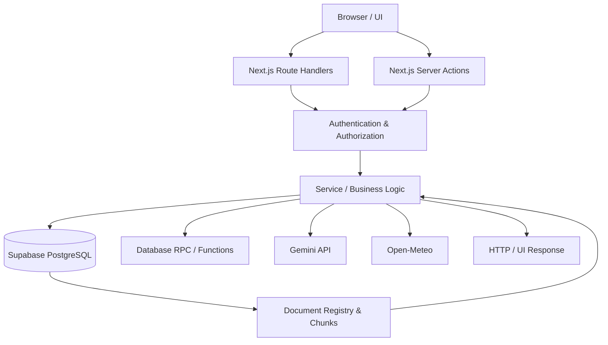
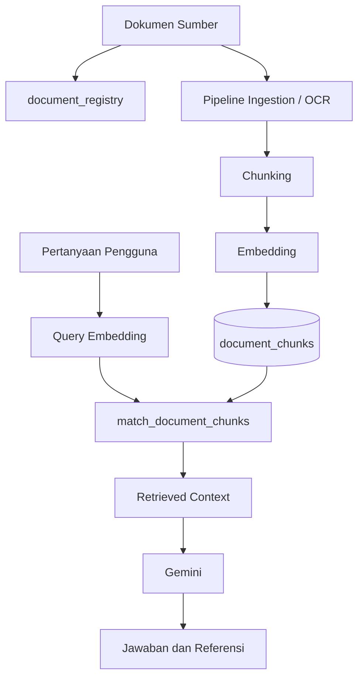
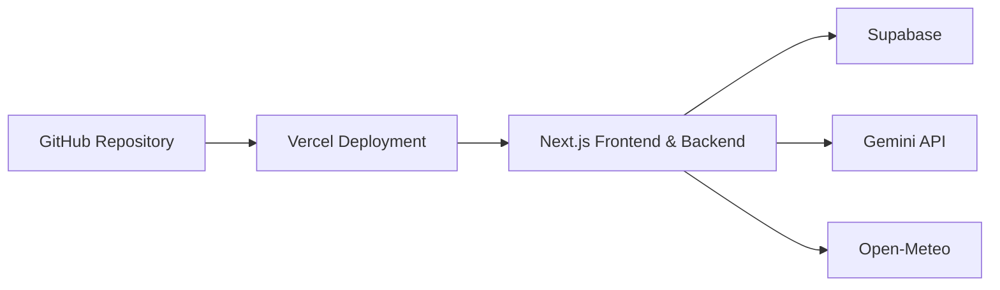

# AIRA — Dokumentasi Teknis Backend

Dokumentasi ini menjelaskan arsitektur backend AIRA, alur komunikasi dan pemrosesan fitur, layanan pendukung, autentikasi dan otorisasi, integrasi database dan AI, konfigurasi environment, serta aspek teknis yang perlu diperhatikan dalam pengembangan dan deployment.

Dokumen disusun berdasarkan informasi implementasi repository `aira-website` dan dokumentasi teknis yang tersedia. Detail kebijakan database seperti RLS, grants, trigger, dan definisi lengkap fungsi PostgreSQL perlu merujuk pada konfigurasi SQL aktual Supabase; bagian yang belum memiliki bukti konfigurasi lengkap tidak dianggap sebagai hasil audit menyeluruh.

## 1. Arsitektur Backend

AIRA menggunakan satu repository dan satu aplikasi Next.js App Router berbasis JavaScript untuk Front-End dan Back-End. Route Handlers menyediakan endpoint HTTP, sedangkan Server Actions menangani proses server-side yang dipanggil langsung dari UI. Supabase digunakan untuk autentikasi dan database PostgreSQL, sementara Vercel merupakan platform deployment aplikasi.

Komponen utama arsitektur:

- **Web application:** Next.js App Router dan JavaScript.
- **HTTP API:** Next.js Route Handlers di `app/api/**/route.js`.
- **Server-side mutations:** Server Actions di `app/actions/**/*.js`.
- **Database dan autentikasi:** Supabase PostgreSQL dan Supabase Auth.
- **AI provider:** Gemini API untuk Assistant dan proses AI terkait rekomendasi sesuai implementasi.
- **Data curah hujan:** Open-Meteo melalui service terkait.
- **RAG:** Dokumen, chunk, embedding, dan retrieval melalui Supabase serta pipeline ingestion.
- **Deployment:** Vercel dengan konfigurasi environment variables.



Secara umum, request dari browser diterima oleh Route Handler atau Server Action, melewati validasi dan pemeriksaan akses yang relevan, lalu diteruskan ke service atau proses domain. Service berinteraksi dengan Supabase, database RPC, Gemini, atau Open-Meteo sesuai kebutuhan fitur. Hasil pemrosesan kemudian disampaikan kembali kepada UI.

## 2. Layer dan Tanggung Jawab

| Layer | Lokasi | Tanggung jawab |
|---|---|---|
| HTTP/API | `app/api/**/route.js` | Parsing request, validasi, pemeriksaan akses, pemanggilan service, serta response dan HTTP status. |
| Server Actions | `app/actions/**/*.js` | Operasi server-side yang terhubung langsung dengan UI, termasuk form dan mutasi. |
| Service | `services/**/*.js` | Logika domain, orchestration proses, integrasi provider, dan akses data. |
| Auth helper | `lib/auth/**` | Pemeriksaan sesi pengguna, status akun, dan role admin. |
| Supabase helper | `lib/supabase/**` | Konfigurasi client Supabase untuk konteks browser/server. |
| Database | Supabase PostgreSQL | Penyimpanan data aplikasi, relasi, serta fungsi database. |
| Database RPC | Fungsi PostgreSQL | Proses database khusus, termasuk proses review atau penghapusan yang dikelola fungsi database. |
| Pipeline RAG | `pipeline/ingest.py` dan workflow terkait | Ingestion dokumen, ekstraksi/OCR, chunking, embedding, dan penyimpanan data retrieval. |

## 3. Authentication dan Authorization

AIRA menggunakan Supabase Auth sebagai sumber autentikasi dan sesi pengguna.

- Identitas pengguna pada sisi server diperoleh melalui autentikasi server, seperti `supabase.auth.getUser()` atau helper yang mengandalkan sesi tersebut.
- Identitas pengguna dan role tidak dipercaya apabila hanya disampaikan melalui request body atau parameter klien.
- Helper `requireApiUser()` dan `requireApiAdmin()` tersedia pada `lib/auth/authorization.js` untuk pemeriksaan akses API sesuai implementasi.
- Pemeriksaan admin aktif juga terdapat pada `lib/auth/requireAdmin.js`, yang memeriksa sesi, profil pengguna, role `admin`, serta status akun `active`.
- Sebagian proses service/database juga memanfaatkan pemeriksaan admin melalui RPC `is_aira_admin`.
- Server Actions memerlukan pemeriksaan autentikasi dan otorisasi server-side. Menyembunyikan tombol atau halaman pada UI bukan pengganti pemeriksaan akses.
- RLS Supabase merupakan lapisan pertahanan tambahan (defense-in-depth), bukan pengganti validasi dan pemeriksaan akses pada backend.

### 3.1 Kategori akses

| Kategori | Contoh endpoint / fitur | Akses |
|---|---|---|
| Public | `/api/water-navigation`, `/api/water-navigation/{id}` | Data titik air yang memenuhi kriteria publikasi. |
| Public | `POST /api/assistant` | Pengajuan pertanyaan kepada AIRA Assistant. |
| Public / Guest | `POST /api/water-assessments` | Perhitungan ketahanan air; penyimpanan riwayat terkait sesi login. |
| User | Profile, households, assessment history, contributions | Memerlukan sesi pengguna yang valid dan pemeriksaan kepemilikan data. |
| Admin | `/api/admin/**` | Memerlukan autentikasi dan hak akses admin sesuai implementasi. |

Endpoint publik tetap memiliki validasi request dan aturan domain. Public tidak berarti semua data atau operasi database dapat diakses secara bebas.

## 4. Database dan Fungsi yang Digunakan

Nama tabel, kolom, dan RPC di bawah ini merangkum objek database yang dirujuk oleh source code atau dokumentasi schema yang tersedia. Daftar ini bukan pengganti schema SQL aktual maupun audit kebijakan RLS.

| Tabel / RPC | Kegunaan |
|---|---|
| `users` | Profil pengguna, identitas, role, dan status akun. |
| `households` | Data rumah tangga dan informasi terkait wilayah/anggota. |
| `water_points` | Data titik air yang dikelola dan dapat ditampilkan sesuai aturan publikasi. |
| `water_point_contributions` | Usulan titik air baru atau pembaruan data dari pengguna. |
| `contribution_reviews` | Riwayat keputusan review kontribusi. |
| `water_assessments` | Hasil kalkulator/asesmen ketahanan air. |
| `assessment_recommendations` | Rekomendasi yang terkait dengan hasil asesmen. |
| `assistant_interactions` | Riwayat interaksi Assistant untuk pengguna login sesuai implementasi. |
| `admin_activity_logs` | Catatan aktivitas administratif. |
| `provinces`, `city_regencies`, `districts` | Data referensi wilayah administratif. |
| `document_registry` | Metadata dokumen sumber knowledge base RAG. |
| `document_chunks` | Potongan dokumen, metadata chunk, dan embedding. |
| `is_aira_admin()` | Pemeriksaan hak admin melalui fungsi database pada proses yang menggunakannya. |
| `review_water_point_contribution(...)` | Proses review kontribusi dan pembaruan status melalui RPC. |
| `match_document_chunks(...)` | Retrieval chunk dokumen berdasarkan kemiripan embedding. |
| `delete_my_water_assessment` | Proses penghapusan asesmen milik pengguna sesuai aturan database. |

### 4.1 Catatan verifikasi database

Schema tabel dan relasi dapat dirujuk melalui dokumentasi schema/ERD yang tersedia di repository, termasuk `docs/DB_SCHEMA_AUDIT.md` dan `docs/aira-core-erd.dbml` apabila file tersebut tersedia pada branch terkait.

Hal yang memerlukan rujukan konfigurasi SQL aktual untuk verifikasi lengkap meliputi:

- RLS policies dan grants pada seluruh tabel terkait, termasuk perbedaan akses anon, authenticated, dan admin.
- Definisi, signature, dan body aktual fungsi `review_water_point_contribution`, `is_aira_admin`, `match_document_chunks`, serta `delete_my_water_assessment`.
- Trigger, constraint, dan perilaku foreign key/`ON DELETE` aktual.
- Keberadaan dan struktur kolom kontribusi untuk detail pengelola, nomor telepon, dan tautan Maps. Pada form yang terdokumentasi, informasi pengelola berada dalam `proposed_access_information` dan tautan bukti berada dalam `evidence_url`.
- Constraint atau enum yang membatasi nilai `action_type` pada `admin_activity_logs`.

## 5. Service dan Domain Utama

| Service / file | Tanggung jawab |
|---|---|
| `services/contributionService.js` | Pengiriman kontribusi, riwayat pengguna, antrean admin, dan review kontribusi. |
| `services/adminTitikAirService.js` | Pengambilan dan pemetaan data titik air untuk pengelolaan admin. |
| `services/waterPointAdminService.js` | Operasi admin water-point sesuai build/branch yang memuat service tersebut. |
| `app/actions/admin-titik-air.js` | Server Action administratif untuk pembaruan data operasional titik air terverifikasi sesuai implementasi. |
| `services/curahHujanService.js` | Geocoding dan pengambilan data curah hujan historis Open-Meteo. |
| `services/calculatorService.js` | Kalkulasi kebutuhan air, ketahanan, dan potensi panen hujan secara deterministik. |
| `services/rekomendasiService.js` | Rule engine dan orchestration rekomendasi. |
| `services/assistantService.js` | Retrieval dokumen dan generasi jawaban AIRA Assistant. |
| `services/aiService.js` | Penjelasan atau pemilihan tambahan berbasis AI pada proses rekomendasi sesuai implementasi. |
| `services/adminActivityLogService.js` | Pengambilan catatan aktivitas admin. |

Nama dan tanggung jawab service dapat berubah mengikuti branch atau build repository. Dokumentasi ini menggambarkan pemetaan yang tersedia pada basis dokumentasi proyek.

## 6. Alur Fitur End-to-End

### 6.1 Kalkulator Ketahanan Air

Kalkulator menerima data rumah tangga dan kondisi air, antara lain wilayah, jumlah anggota, sumber air, kondisi ketersediaan, kapasitas/volume, parameter MHM, dan luas atap apabila digunakan.

Pemrosesan kebutuhan air, ketahanan, status, dan rekomendasi dilakukan melalui service kalkulator serta rule engine pada backend. Estimasi panen hujan menggunakan data curah hujan dari Open-Meteo ketika data wilayah tersedia. Pengguna tamu dapat menjalankan kalkulasi; penyimpanan riwayat dikaitkan dengan sesi pengguna apabila tersedia dan proses penyimpanan berhasil.

Wilayah yang tidak memiliki data estimasi tidak digantikan dengan angka curah hujan dari wilayah lain. Ketersediaan data estimasi menjadi batasan hasil kalkulasi panen hujan.

### 6.2 Navigasi Air

Navigasi Air menggunakan endpoint publik yang mengembalikan titik air sesuai kriteria publikasi, yaitu titik yang aktif, terverifikasi, dan bukan data simulasi.

Endpoint publik untuk daftar dan detail titik air dipisahkan dari endpoint pengelolaan administratif. Data kandidat dari sumber seperti OSM atau Pusdatin yang berada pada tabel staging tidak otomatis menjadi bagian dari direktori publik. Tampilan navigasi menggunakan tautan peta eksternal sesuai implementasi UI, bukan marker peta internal.

### 6.3 Kontribusi komunitas

Pengguna yang telah login dapat mengirim usulan titik air baru atau usulan pembaruan titik air. Data usulan disimpan sebagai contribution dan tidak langsung dipublikasikan sebagai water point terkonfirmasi.

Admin memeriksa kontribusi dan menetapkan status review seperti `approved`, `needs_revision`, atau `rejected`. Persetujuan dapat menghasilkan pembaruan atau penyediaan data operasional titik air melalui service/RPC yang digunakan. Riwayat review dan catatan review mendukung penelusuran proses verifikasi.

### 6.4 AIRA Assistant (RAG)

AIRA Assistant memvalidasi pertanyaan, mengambil konteks dari knowledge base melalui retrieval, lalu menggunakan model Gemini untuk menyusun jawaban berdasarkan konteks yang tersedia. Referensi yang dapat disajikan dikembalikan bersama jawaban sesuai hasil retrieval dan implementasi.

Interaksi dapat disimpan untuk pengguna login sesuai implementasi. Assistant menggunakan pendekatan RAG untuk pertanyaan informasi; sistem rekomendasi kalkulator tetap ditentukan oleh rule engine. AI dapat digunakan untuk membantu penjelasan atau seleksi tambahan sesuai implementasi service, bukan menggantikan aturan kalkulasi deterministik.

### 6.5 User dan Admin Dashboard

Dashboard pengguna menyediakan akses terhadap profil, data rumah tangga, riwayat kalkulator, serta kontribusi dan status prosesnya. Dashboard admin mendukung pengelolaan titik air, review kontribusi, pengelolaan akun pengguna, ringkasan dashboard, dan activity logs melalui route atau Server Action yang memiliki pemeriksaan akses admin.

## 7. AI, RAG, dan Responsible AI

Use case AI utama AIRA adalah AIRA Assistant dengan pendekatan Retrieval-Augmented Generation (RAG), didukung rule-based recommendation pada kalkulator.

### 7.1 Pipeline RAG

Alur pipeline ingestion dan retrieval secara umum:

1. Metadata dokumen sumber dicatat di `document_registry`.
2. Pipeline `pipeline/ingest.py` memproses dokumen, termasuk ekstraksi teks atau OCR apabila diperlukan.
3. Teks dipecah menjadi chunk sesuai konfigurasi chunking.
4. Embedding dibuat menggunakan model embedding yang dikonfigurasi.
5. Chunk dan metadata terkait disimpan ke `document_chunks` pada Supabase.
6. Pertanyaan Assistant diproses menjadi embedding query.
7. Retrieval dilakukan melalui fungsi `match_document_chunks` atau mekanisme retrieval yang relevan.
8. Gemini menghasilkan jawaban dengan konteks hasil retrieval, dan referensi dikembalikan apabila tersedia.



### 7.2 Konfigurasi embedding dan retrieval

Dokumentasi schema yang dirujuk mencatat dimensi embedding 768. Dimensi, model embedding, struktur tabel, fungsi retrieval, dan index perlu diselaraskan ketika terjadi perubahan konfigurasi. Perubahan pada salah satu komponen tanpa penyesuaian pipeline ingestion dan retrieval dapat menyebabkan incompatibility.

### 7.3 Batasan dan prinsip penggunaan AI

- Model generatif digunakan melalui backend; API key tidak dikirim ke browser.
- Jawaban Assistant didasarkan pada konteks retrieval yang tersedia. Kualitas jawaban dipengaruhi kelengkapan, relevansi, dan aktualitas dokumen.
- Ketika sumber tidak memadai atau retrieval gagal, Assistant perlu menyatakan keterbatasan sumber dan tidak mengarang rujukan.
- AI dapat menghasilkan informasi yang keliru. AIRA bukan pengganti pengujian kualitas air, tenaga profesional, atau layanan darurat.
- Data identitas dan data rumah tangga tidak perlu dikirim ke model apabila tidak relevan dengan pertanyaan atau proses.
- Evaluasi AI dapat mencakup pertanyaan yang didukung sumber, pertanyaan di luar knowledge base, sumber tidak relevan, input kosong/terlalu panjang, timeout, dan variasi topik air, sanitasi, serta MHM. Hasil evaluasi khusus perlu dicatat berdasarkan pengujian yang benar-benar dilakukan.

## 8. Validasi dan Error Handling

API dan proses backend mempertimbangkan validasi format request, tipe data, panjang/range nilai, enum, identifier resource, kepemilikan data, dan aturan bisnis sesuai kebutuhan endpoint.

Error response menggunakan HTTP status yang relevan. Bentuk respons pada beberapa endpoint legacy dapat berbeda; detail format response API dirujuk pada `API.md`.

| HTTP Status | Kondisi umum |
|---|---|
| `400` | Request tidak valid atau format/parameter tidak sesuai. |
| `401` | Sesi autentikasi tidak tersedia atau tidak valid. |
| `403` | Hak akses tidak mencukupi. |
| `404` | Resource tidak ditemukan atau tidak dapat diakses. |
| `422` | Validasi domain atau input gagal. |
| `429` | Rate limit, apabila mekanisme tersebut diterapkan dan aktif. |
| `502` | Kegagalan layanan upstream. |
| `503` | Provider atau dependency tidak tersedia. |
| `504` | Timeout pada dependency atau request. |

Respons error tidak seharusnya mengekspos stack trace, secret, atau informasi sensitif konfigurasi.

## 9. Pengelolaan Resource dan Integritas Data

Pengelolaan resource backend mengikuti aturan domain, ownership, relasi database, dan proses bisnis. Operasi penghapusan tidak selalu berupa penghapusan fisik.

### 9.1 Water Assessment

Penghapusan asesmen menggunakan RPC `delete_my_water_assessment` sesuai implementasi yang didokumentasikan. Fungsi database memeriksa kepemilikan berdasarkan identitas pengguna dan memproses penghapusan asesmen serta dependensi langsung yang terkait, termasuk rekomendasi dan interaksi Assistant, secara transaksional sesuai fungsi tersebut.

### 9.2 Review kontribusi

Service review kontribusi menggunakan RPC untuk memproses status review dan pilihan ketersediaan akhir sesuai workflow. Dokumentasi yang tersedia menyebut wrapper empat-argument yang meneruskan workflow inti kepada fungsi review tiga-argument yang telah ada. Signature dan body aktual perlu merujuk pada migration SQL/database.

### 9.3 Admin Water Point

Route Handlers pengelolaan admin water-point menggunakan service terkait dan pemeriksaan admin. Payload operasi divalidasi dan identitas verifier berasal dari sesi server.

<text>
DELETE pada pengelolaan Admin Water Point menggunakan **hard delete**: data titik air dihapus dari tabel `water_points` ketika admin menjalankan aksi penghapusan. Data riwayat kontribusi pada tabel `contributions` tetap dipertahankan, sehingga catatan kontribusi dan proses review tidak ikut dihapus bersama record titik air. Mekanisme soft delete (`is_active=false`) sebelumnya menimbulkan error pada implementasi, sehingga alur penghapusan diperbarui menjadi penghapusan fisik pada tabel `water_points`.
</text>

### 9.4 Admin Overview

Endpoint `/api/admin/overview` menyajikan ringkasan data administratif yang berasal dari data Supabase, termasuk ringkasan titik air, titik aktif-terverifikasi-non-simulasi, titik nonaktif, data simulasi, jumlah kontribusi, serta distribusi status kontribusi sesuai implementasi.

## 10. Environment Variables

Variabel environment yang dirujuk source code atau konfigurasi pipeline meliputi:

| Variable | Kegunaan umum |
|---|---|
| `NEXT_PUBLIC_SUPABASE_URL` | URL Supabase yang digunakan aplikasi client. |
| `NEXT_PUBLIC_SUPABASE_ANON_KEY` atau `NEXT_PUBLIC_SUPABASE_PUBLISHABLE_KEY` | Key publik Supabase untuk konteks client sesuai konfigurasi. |
| `SUPABASE_URL` | URL Supabase untuk konteks server/pipeline. |
| `SUPABASE_SERVICE_ROLE_KEY` | Key dengan hak layanan untuk proses server/pipeline tertentu; server-only. |
| `GEMINI_API_KEY` | Autentikasi layanan Gemini. |
| `GEMINI_EMBEDDING_MODEL` | Model embedding yang digunakan pipeline atau retrieval. |
| `EMBEDDING_DIMENSION` | Dimensi embedding yang dikonfigurasi. |
| `GEMINI_ASSISTANT_MODELS` atau `GEMINI_MODELS` | Konfigurasi model generatif yang digunakan. |
| `GEMINI_MODEL_TIMEOUT_MS` | Timeout pemanggilan model. |
| `TOP_K` | Jumlah hasil retrieval yang dikonfigurasi. |
| `EXACT_DOCUMENT_CHUNKS` | Konfigurasi retrieval chunk dokumen tertentu. |
| `SIMILARITY_THRESHOLD` | Ambang similarity retrieval. |
| `SUPABASE_TABLE_KATALOG` | Konfigurasi tabel katalog jika digunakan. |
| `NEXT_PUBLIC_SITE_URL` | URL aplikasi untuk kebutuhan konfigurasi site. |

Nilai environment yang bersifat rahasia tidak disimpan di repository, dokumentasi publik, screenshot, atau laporan. `SUPABASE_SERVICE_ROLE_KEY` dan `GEMINI_API_KEY` hanya digunakan pada lingkungan server/pipeline yang sesuai dan tidak boleh diekspos ke browser.

Konfigurasi lokal umumnya berada pada `.env.local`, sedangkan environment deployment dikelola melalui Vercel Environment Variables. Environment Preview dan Production perlu menggunakan konfigurasi Supabase serta provider yang sesuai dengan target deployment.

## 11. Build, Test, dan Deployment

Perintah yang digunakan dalam workflow project berbasis npm:

```bash
npm ci
npm test
npm run lint
npm run build
npm run dev
```

Perintah tersebut merupakan bagian dari workflow pengembangan. Ketersediaan dan hasil masing-masing script bergantung pada script yang terdaftar dalam `package.json` pada branch yang digunakan.

### 11.1 Deployment

AIRA menggunakan Next.js sebagai aplikasi web sekaligus backend API. Deployment aplikasi dilakukan melalui Vercel, sementara Supabase dan Gemini diakses melalui konfigurasi environment.

Alur deployment yang digunakan dalam konteks project:



### 11.2 Verifikasi deployment

Verifikasi deployment melibatkan kesesuaian environment variables, project Supabase, tabel/RPC yang digunakan, akses user dan admin, serta pengujian fitur pada lingkungan deployment. Pengujian di lingkungan lokal tidak dengan sendirinya membuktikan konfigurasi atau hasil pada deployment Preview/Production.

## 12. Pengujian Backend

Pengujian endpoint API AIRA telah dilakukan menggunakan Thunder Client. Endpoint yang diuji dapat dijalankan sesuai alur dan fungsi yang diharapkan, dengan hasil pengujian menunjukkan bahwa proses request dan response berjalan baik pada skenario pengujian yang dilakukan. Pengujian ini membantu memvalidasi integrasi backend, alur data, serta interaksi endpoint dengan layanan dan database yang digunakan aplikasi. Dokumentasi detail endpoint dan pengujian API juga tersedia pada `API.md`.

## 13. Cakupan Dokumentasi

Dokumen ini merangkum implementasi backend AIRA, alur pemrosesan fitur, integrasi layanan, pengelolaan data, dan hasil pengujian fungsional API yang telah dilakukan. Pengujian endpoint menggunakan Thunder Client menjadi bagian dari validasi implementasi backend. Pemeriksaan lebih mendalam seperti penetration testing, pengujian beban, serta audit menyeluruh terhadap konfigurasi keamanan database dan infrastruktur merupakan aktivitas terpisah dari pengujian fungsional API dan tidak menjadi cakupan klaim hasil pada dokumen ini.

## 14. Referensi Dokumentasi Project

Dokumentasi terkait yang dapat digunakan bersama dokumen ini, apabila tersedia pada repository:

| Dokumen | Keterangan |
|---|---|
| `API.md` | Daftar endpoint, request/response, dan hasil pengujian API. |
| `docs/DB_SCHEMA_AUDIT.md` | Dokumentasi audit schema database. |
| `docs/aira-core-erd.dbml` | ERD inti AIRA dalam format DBML. |
| `docs/DB_MIGRATION_GUIDE.md` | Panduan migrasi database. |
| `docs/REPAIR_AUDIT_REPORT.md` | Laporan audit/perbaikan terkait database atau implementasi. |
| `docs/UAT_CHECKLIST.md` | Checklist User Acceptance Testing apabila tersedia. |

## 15. Kesimpulan

Backend AIRA dibangun dalam satu aplikasi Next.js App Router yang mengintegrasikan Route Handlers, Server Actions, service layer, Supabase Auth dan PostgreSQL, serta layanan pendukung seperti Gemini dan Open-Meteo. Arsitektur ini mendukung kalkulator ketahanan air, Navigasi Air, kontribusi komunitas, AIRA Assistant berbasis RAG, dashboard pengguna, dan pengelolaan administratif.

Pemeriksaan autentikasi dan otorisasi, validasi input, aturan domain, serta mekanisme database digunakan untuk menjaga alur pengelolaan data. Proses seperti review kontribusi, penghapusan asesmen, dan penonaktifan titik air memiliki aturan khusus untuk mendukung integritas dan keterlacakan data.

Dokumentasi ini menjadi referensi teknis backend AIRA untuk memahami arsitektur, komponen, alur fitur, integrasi, konfigurasi, dan batas verifikasi implementasi yang tersedia.
